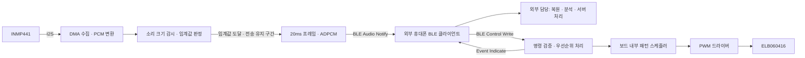

# XIAO ESP32-S3 · INMP441 · ELB060416 코드 작성 하네스 설계

> 초기 설계 배경 문서입니다. 구현된 v1.0 규격은 contracts/protocol.md, 실행 방법은 README.md, 실제로 완료한 검증은 docs/STATUS.ko.md를 기준으로 합니다. 후보 모듈은 아직 확정된 부품이 아닙니다.

작성 기준: 2026-10-29. 구현 범위는 ESP32 펌웨어·BLE 인터페이스·PC 테스트 하네스다. 휴대폰 앱 개발은 외부 범위다. 이 문서는 구현 명세와 검증 하네스의 설계이며, 완성 펌웨어나 실제 보드 검증 결과가 아니다.

## 1. 목표와 범위

여기서 하네스는 **코딩 도구가 같은 명세를 따라 보드 펌웨어와 BLE 송수신 API를 작성하고, PC에서 검증한 뒤 실제 보드로 합격 여부를 확인하는 개발 환경**을 뜻한다. 휴대폰 앱 코드는 작성하지 않는다. 휴대폰 측 연동을 위한 산출물은 통신 규격·패킷 예제·공통 테스트 벡터다.

최종 동작:

1. 외장 INMP441에서 계속 수집하며, 보드에서 소리 크기를 감시한다.
2. 설정 임계값 이상의 소리가 감지될 때마다 XIAO ESP32-S3가 BLE로 Android 앱에 오디오를 자동 전송한다. 큰 소리가 계속되면 전송도 계속한다.
3. 휴대폰 측에서 해석할 수 있도록 오디오 프레임·ADPCM 블록 규격과 테스트 벡터를 제공한다. 앱의 복원·분석·재생 구현은 외부 담당이다.
4. 휴대폰이 강도·패턴·반복 횟수를 담은 BLE 명령을 보내면 보드가 ELB060416을 제어한다.
5. 음성 전송 중에도 진동 명령과 중지 명령이 처리된다.

기본 범위는 BLE 클라이언트가 연결·구독하고 수신 세션을 활성화한 동안의 자동 전송이다. 휴대폰 측은 연결/재연결 후 감지 설정과 수신을 자동 활성화하는 계약을 따른다. 감지 이벤트마다 휴대폰의 새 시작 요청은 필요 없다. 보드의 소리 감시는 전원이 켜진 동안 계속하지만, 연결이 끊긴 동안의 소리를 실시간으로 휴대폰에 전달할 수는 없다. 휴대폰의 연결 유지·권한·백그라운드·소리 분석·서버 연동은 휴대폰 측 담당이다. 보드 펌웨어의 테스트에는 PC BLE 클라이언트를 사용하고, 실제 휴대폰 연동 결과는 별도로 기록한다.

여기서 API는 HTTP URL이 아니라 BLE GATT 서비스/특성 및 바이너리 메시지 계약을 의미한다. 휴대폰 측에는 이 서비스를 구독하고 명령을 쓰는 BLE 클라이언트가 필요하다. BLE 연결만으로 휴대폰의 임의 HTTP API나 운영체제 마이크 입력에 자동 연결되는 것으로 가정하지 않는다.

## 2. 확인된 제약과 미확정 사항

| 구분 | 설계 판단 | 근거/처리 |
|---|---|---|
| Bluetooth | BLE GATT 기반 전용 앱 사용 | S3의 Bluetooth는 LE이며 Classic SPP/A2DP 경로를 사용하지 않음. [Espressif 사양](https://www.espressif.com/sites/default/files/documentation/esp32-s3_datasheet_en.pdf) |
| 오디오 입력 | I2S standard Philips, 32-bit × 2 슬롯, 왼쪽 추출 | INMP441의 24-bit I2S 데이터와 프레임당 64 SCK에 맞춤. [TDK 데이터시트](https://invensense.tdk.com/wp-content/uploads/2015/02/INMP441.pdf) |
| 핀 번호 | D 표기와 실제 GPIO를 같이 고정 | [Seeed 핀맵](https://wiki.seeedstudio.com/xiao_esp32s3_getting_started/) |
| 진동 부품 | ELB060416 제어 모듈용 PWM 백엔드부터 설계 | 제조사 원본 회로·정격·입력 임계전압은 아직 확보하지 못함. 실물/구매 자료 확인 전에는 전원 배선과 출력 활성화를 확정하지 않음 |
| 휴대폰 | Android를 첫 연동 대상으로 고려 | 앱 개발은 외부 범위. 보드 측 BLE 계약은 특정 앱 언어에 의존하지 않음 |

ELB060416의 판매명만으로 모터 전류, 3.3V 입력 호환, 보호회로, PWM 주파수 범위를 확정하지 않는다. 입력이 있는 모듈인지 모터 단품인지 확인한다. 실제 부품이 LRA 등 다른 구동을 요구하면 HapticDriver 구현을 교체한다. 특정 추가 드라이버 구매를 전제로 하지 않는다.

## 3. 전체 구성



보드가 제공하는 API는 Audio Notify·Control Write·Event Indicate·Capabilities Read다. 휴대폰 내부 API와 화면은 이 프로젝트에서 구현하지 않는다. 별도 `BLE_INTERFACE.ko.md`를 휴대폰 측 연동 문서로 제공한다.

## 4. 배선 계획과 하드웨어 프로파일

외장 INMP441을 사용하는 일반 XIAO ESP32-S3를 기준으로 한 제안이다. Sense 확장보드, 카메라, SD 등 다른 장치가 같은 핀을 점유하는지는 조립 전에 확인한다.

| XIAO 표기 | 실제 GPIO/전원 | 연결 제안 |
|---|---|---|
| D8 | GPIO7 | INMP441 SCK/BCLK |
| D9 | GPIO8 | INMP441 WS/LRCLK |
| D10 | GPIO9 | INMP441 SD → 보드 입력 |
| 3V3 | 3.3V | INMP441 VDD |
| GND | 공통 접지 | INMP441 GND, L/R=LOW로 왼쪽 채널 선택 |
| D0 | GPIO1 | 확인된 ELB060416 모듈의 제어 입력으로 가는 PWM 신호 |
| 별도 전원 경로 | 부품 정격 확인 후 지정 | 진동 모듈 전원. GPIO는 제어 신호만 담당 |

마이크 근처 바이패스와 SD 풀다운은 사용 중인 모듈 회로 및 데이터시트에 따라 확인한다. 진동 부품의 VCC를 GPIO나 마이크 전원에서 공급하지 않는다. 전원 전류 예산과 3.3V 논리 호환을 확인한 후 모듈 전원·레벨 변환 필요성을 결정한다. 부팅과 리셋 중에도 제어 입력이 OFF가 되도록 회로의 기본 상태를 확인한다.

`hardware_profile`에는 다음을 기록한다.

```yaml
board: xiao_esp32s3
mic: inmp441
i2s: {bclk_gpio: 7, ws_gpio: 8, din_gpio: 9, selected_slot: left}
haptic:
  control_gpio: 1
  backend: pwm_module
  enabled: false
  supply_voltage_v: null
  peak_current_ma: null
  input_3v3_verified: false
  pwm_frequency_hz: null
  weak_duty: null
  strong_duty: null
```

미확정 항목은 실제 보드 출력 활성화의 조건이다. 소프트웨어 개발은 MockHapticDriver로 계속한다. 전원 리비전·모듈 사진·측정 결과를 프로파일과 함께 보관한다.

## 5. 오디오 프로파일과 지연 예산

| 프로파일 ID | 수집/출력 | 프레임 | 프레임 본문 | 용도 |
|---|---|---|---|---|
| 1 | 16kHz mono, PCM16 → IMA 계열 ADPCM4 | 20ms, 320 samples | 164 bytes | 기본 |
| 2 | 8kHz mono, PCM16 → ADPCM4 | 20ms, 160 samples | 84 bytes | 저대역폭 선택 모드 |
| 3 | 16kHz mono, PCM16 little-endian | 20ms, 320 samples | 640 bytes | 품질 비교·진단 |

4-bit ADPCM의 연속 코드 부분은 16,000 samples/s × 4 bits/sample = 64,000 bits/s, 즉 64kbps(8KB/s)다. PCM16의 256kbps와 비교하면 약 4:1이다. 64kbps는 ADPCM 전체에 공통인 고정값이 아니라 이 샘플링 속도·채널 수·bit 수의 결과다. 8kHz mono라면 같은 계산으로 32kbps다. [4-bit IMA 계열 ADPCM 참고](https://www.rfc-editor.org/rfc/rfc3551.html#section-4.5.1)

이 설계의 프로파일 1은 첫 샘플과 predictor/index를 담은 독립 블록이므로 본문 164 bytes × 50 × 8 = 65.6kbps다. 16-byte 전송 헤더까지 붙이면 180 bytes × 50 = 9,000 bytes/s, 72kbps다. 무선 링크·ATT·제어 메시지 등의 추가 비용은 별도다. PCM 자체는 16,000 × 16 = 256kbps이며 조각별 헤더도 추가된다. PHY의 2Mbps 표기는 앱 처리량 보장이 아니다. 자동 감지로 전송하지 않는 시간이 있으면 장기 평균 데이터량은 줄지만, 큰 소리가 계속될 때의 처리량은 이 연속 전송 기준으로 확보한다.

ADPCM은 손실 압축이므로 실제 목적이 소리 분류나 ASR이면 PCM 기준 결과와 비교한다. 품질이 부족하면 PCM 처리량을 실제 폰에서 측정하거나 코덱을 별도 단계에서 교체한다. 샘플링 속도·코덱 변경은 앱이 명시적으로 승인한 뒤 새 스트림으로 시작한다.

초기 지연 예산은 20ms 수집 + 최대 40ms 보드 큐 대기 + 무선/앱 처리 + 40~60ms 앱 지터 버퍼다. 목표는 보드 수집→앱 PCM 전달 p95 200ms 이하이며 실측으로 확정한다. 재생 장치, 소리 인식, 인터넷, 서버 응답의 추가 지연은 별도로 잰다.

I2S 수신은 32-bit stereo slot으로 시작해 왼쪽 슬롯만 추출한다. 16kHz에서 BCLK는 1.024MHz다. 수신 워드 정렬을 확인해 유효 24-bit 부호값을 얻고, 고정소수점 gain 후 saturation으로 PCM16을 만든다. 임의의 비트 shift로 음량을 맞추지 않는다. 정렬·부호·음량·클리핑을 캡처 데이터와 테스트 톤으로 확인한다. 드라이버는 [ESP-IDF standard I2S API](https://docs.espressif.com/projects/esp-idf/en/stable/esp32s3/api-reference/peripherals/i2s.html)를 사용한다.

### 5.1 소리 크기에 따른 자동 전송

발화 여부를 분류하는 VAD가 아니라 **소리 크기를 기준으로 한 감지**다. 말소리 외에 박수·충격음·경보음도 같은 기준으로 처리한다. 감지기는 압축 전, 고정 gain/AGC 적용 전의 마이크 유효 24-bit 데이터를 사용한다. DC 성분 제거 후 full-scale로 정규화해 `rms = sqrt(mean(x*x))`, `level_dbfs = 20*log10(max(rms, epsilon))`으로 계산한다. 누적 제곱합은 overflow가 없게 구현한다.

| 설정 | 초기값/동작 |
|---|---|
| 감지 창/갱신 | 10ms RMS 창, 5ms마다 판정 |
| 전송 시작 | level_dbfs >= on_threshold. 한 번의 유효 판정으로 시작하며 여러 창의 연속 초과를 요구하지 않음 |
| 시작 임계값 | 초기 튜닝값 -45dBFS. 앱에서 변경 가능하며 사용 환경에서 보정 |
| 종료 임계값 | 초기 -50dBFS. 시작값보다 최소 3dB 낮게 설정해 경계에서 켜짐/꺼짐 반복 방지 |
| 전송 유지 | 전송 중 소리가 종료 임계값 이상이면 유지. 종료 임계값 미만 상태가 연속 500ms 지속되면 다음 프레임 경계에서 중단 |
| 시작 전 소리 | 직전 최대 100ms의 완성 PCM 프레임을 pre-roll로 함께 전달해 소리 시작 부분 보존 |
| 감지 대상 | 소리 종류와 무관. 감지 기준에 도달할 때마다 반복 동작 |

임계값은 실제 소음계의 dB SPL이 아니라 디지털 상대 크기인 dBFS다. -45dBFS를 특정 실제 음압으로 단정하지 않는다. dB SPL 기준이 필요하면 알려진 음압에서 장치별로 보정한다. 10ms 창으로 계산한 RMS를 판정 대상으로 정의하며, 임의로 짧은 모든 peak를 검출한다고 주장하지 않는다.

상태는 DISARMED → ARMED_WAITING → TRANSMITTING → ARMED_WAITING이다. START_AUDIO는 자동 감지 전송을 arm하는 명령이고, STOP_AUDIO는 disarm한다. 앱은 유효 연결과 구독 준비 후 START_AUDIO를 자동 호출한다. 보드의 I2S 감시는 DISARMED에서도 계속하지만 그 상태의 오디오를 전송하지 않는다. START_AUDIO 시 stream_id와 sample_index를 초기화하고 pre-roll을 비운다. 소리 burst마다 스트림을 재시작하지 않는다.

감시 중에는 연속 시간축의 sample_index를 진행시킨다. 전송할 프레임을 선택한 시점에만 frame_seq를 부여한다. 조용해서 의도적으로 생략한 구간은 sample_index의 점프와 BURST_START로 표시하고 전송 손실률에 포함하지 않는다. 전송 대상으로 선택된 뒤 혼잡으로 버린 프레임은 손실로 계산한다. 새 burst는 마지막 전송 프레임보다 뒤의 pre-roll만 선택해 중복 음성을 보내지 않는다.

pre-roll은 최대 5개의 완성 프레임을 담는 별도 유한 링 버퍼로 두며, 전송 대기 큐와 분리한다. 시작 시 오래된 pre-roll부터 현재 프레임 순서로 보내되, BLE가 밀리면 pre-roll부터 버려 현재 소리의 지연을 제한한다. PRE_ROLL 프레임의 의도적인 과거 시각은 정상 live 지연 지표와 구분한다. 앱은 BURST_START마다 이전 지터 버퍼를 정리하고, 의도적 무전송 구간을 통신 장애나 무한 재생 버퍼 대기로 처리하지 않는다.

진동 모터가 만드는 소리도 동일한 크기 기준으로 자동 전송하고 MOTOR_ACTIVE를 표시한다. 모터 동작 중이라는 이유로 소리 전송을 차단하지 않는다. 자기 진동으로 앱의 분석→진동 명령이 반복되는 문제는 별도의 앱 제어 정책에서 방지한다.

## 6. BLE 서비스와 API 계약

UUID는 이 프로젝트 전용으로 다음과 같이 고정한다.

| 항목 | UUID | 속성/역할 |
|---|---|---|
| Service | `8e1f0000-6f5a-4d7c-a321-9b7e2c1048d0` | 공통 서비스 |
| Audio | `8e1f0001-6f5a-4d7c-a321-9b7e2c1048d0` | Notify, 보드→폰 |
| Control | `8e1f0002-6f5a-4d7c-a321-9b7e2c1048d0` | Write with response, 폰→보드 |
| Event | `8e1f0003-6f5a-4d7c-a321-9b7e2c1048d0` | Indicate, 처리 결과/상태 |
| Capabilities | `8e1f0004-6f5a-4d7c-a321-9b7e2c1048d0` | Read, 버전·프로파일·패턴 지원 |

최초 연결 절차: 서비스 탐색 → Event 구독 → GET_STATE로 session 수신 → MTU/PHY 협상 → Audio 구독 → SET_DETECTION → START_AUDIO 자동 호출. 각 GATT 작업은 이전 callback 완료 후 실행한다. 캐시된 특성이 다른 펌웨어와 맞지 않으면 재탐색한다.

NimBLE peripheral 1개 연결을 사용한다. MTU 247 이상과 지원되는 경우 2M PHY, 짧은 연결 간격을 요청하되 실제 협상 결과로 동작한다. Android 14 이상은 첫 MTU 요청에서 517을 요청할 수 있으므로 요청 숫자를 실제 MTU로 간주하지 않는다. [Android BluetoothGatt 문서](https://developer.android.com/reference/android/bluetooth/BluetoothGatt)

### 6.1 오디오 패킷 v1

멀티바이트 정수는 little-endian이다. 모든 Notify 조각은 다음 16-byte 헤더를 가진다.

| offset | 필드 | 크기 | 의미 |
|---|---|---|---|
| 0 | version | u8 | 1 |
| 1 | kind | u8 | 1=audio |
| 2 | flags | u8 | bit0=MOTOR_ACTIVE, bit1=DISCONTINUITY, bit2=BURST_START, bit3=BURST_END, bit4=PRE_ROLL |
| 3 | profile_id | u8 | 위 표의 1/2/3 |
| 4 | stream_id | u16 | 연결 내 START마다 바뀌는 ID |
| 6 | frame_seq | u16 | 전송 대상으로 선택된 프레임마다 증가, wrap 허용. 조용해서 생략한 프레임에는 미부여 |
| 8 | first_sample_index | u32 | 해당 스트림 첫 샘플 기준 위치 |
| 12 | frame_bytes | u16 | 완성 프레임 본문 길이 |
| 14 | fragment_offset | u16 | 현재 조각의 본문 내 바이트 위치 |

조각 본문 최대 크기는 `min(ATT_MTU - 3, 244) - 16`이다. MTU 247에서 228 bytes이고, 기본 ADPCM은 한 Notify에 들어간다. MTU 185에서는 최대 166 bytes이므로 기본 프레임 164 bytes가 들어간다. 낮은 MTU에서도 분할 구현은 검사하되, MVP의 연속 오디오는 MTU 185 이상에서 허용한다. 그 미만은 진동 제어만 유지하고 MTU_TOO_SMALL을 보고한다.

재조립 키는 연결 generation + stream_id + frame_seq다. 오프셋·전체 길이·겹침·프로파일의 기대 길이를 검사한다. 첫 조각 도착 후 100ms가 지난 미완성 프레임은 버린다. 늦게 완성된 프레임으로 재생 위치를 되돌리지 않는다. frame_seq와 sample_index wrap은 모듈러 비교로 처리한다.

ADPCM 본문은 이 프로젝트의 독립 블록 형식이며 WAV IMA 블록과 같다고 가정하지 않는다.

* bytes 0..1: PCM 첫 샘플 predictor, signed16 LE.
* byte 2: 첫 nibble 해독 직전 step index, 범위 0..88.
* byte 3: reserved=0.
* 나머지: 두 번째 샘플부터 표준 IMA step/index table로 인코딩. 각 byte는 low nibble 먼저.
* 320 samples이면 319 nibbles=160 bytes, 총 164 bytes. 마지막 high nibble은 0 padding.
* 160 samples이면 159 nibbles=80 bytes, 총 84 bytes.
* 매 블록에 predictor/index가 있으므로 손실된 프레임 이후 블록도 독립적으로 복원한다.

BLE가 제공하는 무결성 검사와 별개로 구조와 길이는 엄격히 검사한다. 일반 실행은 오디오 재전송을 하지 않는다. 프레임 손실은 무음/짧은 concealment와 메트릭으로 처리하고, 기본 저장 파일에는 gap 정보를 남긴다.

### 6.2 제어 패킷 v1

각 명령은 기본 MTU에도 들어가도록 20 bytes 이하다. 공통 헤더는 `version:u8, opcode:u8, command_id:u16, session_id:u32`의 8 bytes다.

| opcode | 이름 | payload |
|---|---|---|
| 0x01 | GET_STATE | 없음. 이 명령만 session_id=0 허용 |
| 0x02 | START_AUDIO | profile_id:u8. 자동 감지 전송을 arm |
| 0x03 | STOP_AUDIO | 없음 |
| 0x04 | SET_DETECTION | on_dbfs_x100:i16, off_dbfs_x100:i16, hold_ms:u16, pre_roll_ms:u16 |
| 0x10 | PLAY_PATTERN | pattern_id:u8, strength:u8(1..100), repeat:u8(1..10), reserved:u8(0), ttl_ms:u16(1..5000) |
| 0x11 | STOP_HAPTIC | 없음 |
| 0x20 | HEARTBEAT | 없음 |

SET_DETECTION은 총 16 bytes다. 두 임계값은 -9000..0 범위이며 off <= on - 300이어야 한다. hold_ms는 0..5000, pre_roll_ms는 0..100 범위에서 20ms 단위다. 설정 변경은 DISARMED에서만 허용하며 그 외에는 BUSY다. 앱의 사용 설정을 연결/재연결 때 다시 적용한다.

연결 때마다 보드는 새 nonzero session_id를 만든다. GET_STATE Event에 현재 session_id를 담는다. 나머지는 일치하지 않으면 SESSION_MISMATCH다. 연결 해제 때 모든 명령·패턴·재조립 상태를 폐기한다.

Event 헤더는 동일한 8 bytes이며 opcode는 원본 명령을 가리킨다. 본문은 `status:u8, detail:u8, device_ms:u32` 6 bytes다. GET_STATE의 경우 `stream_id:u16, state_flags:u8, profile_id:u8` 4 bytes를 추가해 총 18 bytes다. START_AUDIO의 STARTED에는 `stream_id:u16, capture_epoch_ms:u32`를 추가해 총 20 bytes로 한다. capture_epoch_ms는 sample_index=0의 실제 수집 시각이며 device_ms와 같은 보드 단조 시계를 사용한다. 첫 프레임 수집 전에 이 값을 추정해 보내지 않는다. status는 ACCEPTED=1, STARTED=2, COMPLETED=3, STOPPED=4, REJECTED=5다. 오류 detail에는 BAD_LENGTH, BAD_VERSION, BAD_VALUE, BUSY, SESSION_MISMATCH, HARDWARE_UNVERIFIED, MTU_TOO_SMALL, INTERNAL을 정의한다.

GATT write 성공은 명령 실행 성공이 아니다. 앱은 Event를 보고 결과를 확정한다. 파서는 상태를 바꾸기 전에 전체 길이와 범위를 검사한다. 활성 명령과 최근 완료 명령 64개/60초를 (session_id, command_id)로 관리한다. 같은 ID·같은 바이트 재시도는 재실행 없이 최신 결과를 돌려주고, 다른 바이트는 거부한다. 앱은 미완료/보존 중 ID를 재사용하지 않는다.

진동 명령은 기본적으로 한 개만 실행하며 실행 중 PLAY는 BUSY다. 앱에서 패턴 교체는 STOP의 결과를 기다린 뒤 PLAY한다. STOP은 진동 실행 큐의 포화와 무관하게 처리할 전용 플래그/슬롯을 둔다. BLE 송신은 보류된 제어 Event를 오디오보다 우선한다.

### 6.3 보드 측 API와 연결 상대의 책임

| 보드가 제공하는 기능 | 상대 클라이언트가 수행하는 연동 |
|---|---|
| 서비스 광고와 Capabilities | 장치 검색·연결·지원 규격 확인 |
| Audio Notify | 구독·프레임 재조립·ADPCM 해독 |
| Control Write 처리 | 설정·arm·진동·정지 명령 전송 |
| Event Indicate | 구독·명령 ID에 따른 결과 확인 |
| heartbeat lease와 연결 해제 정리 | 활성 진동 세션에서 500ms 주기로 HEARTBEAT 전송 |

threshold/hold/pre-roll 설정 변경은 STOP_AUDIO → SET_DETECTION → START_AUDIO 순서다. 상대 클라이언트는 초기 연결/재연결 때 설정과 arm을 자동 수행하는 계약을 따른다. 이 프로젝트는 Kotlin SDK, Android BLE 연결 코드, 앱 화면을 산출물로 요구하지 않는다. PC 테스트 클라이언트는 같은 바이트 계약을 사용해 보드의 동작을 확인한다.

## 7. 진동 엔진

패턴 전체를 보드가 실행한다. 휴대폰에서 on/off 시점을 연속 전송하지 않는다. 하드웨어 PWM 주파수와 패턴의 시간 간격은 서로 다른 설정이다.

| ID | 패턴 | 논리 세그먼트 예시 |
|---|---|---|
| 1 | SINGLE | 지정 강도로 200ms → OFF |
| 2 | DOUBLE | 150ms ON → 150ms OFF → 150ms ON → OFF |
| 3 | LONG | 지정 강도로 700ms → OFF |
| 4 | RAMP | 1초 동안 5ms 간격으로 약→강 → OFF |
| 5 | SOS | 짧은 3회·긴 3회·짧은 3회, 120/360ms ON, 펄스 간격 120ms, 그룹 간격 360ms → OFF |

소프트웨어 합계 길이가 ttl_ms를 넘으면 재생 시작 전에 거부한다. repeat 사이 간격은 200ms이며 총 길이와 ttl 계산에 포함한다. 단일 패턴 종료 후 최종 OFF가 적용된다. ttl은 명령 수신 시점부터의 보드 내 deadline이며 무한 반복은 없다.

strength는 전압이나 가속도가 아니라 1..100의 논리 입력이다. 드라이버의 검증된 duty lookup table로 변환한다. 약/강의 체감 차이, 최소 기동 duty, 필요시 기동 보정은 실물 측정으로 정한다. 재료·부착 방법·배터리 전압이 바뀌면 재확인한다. ERM처럼 관성이 있는 부품에서는 초단 펄스나 선형 강도 변화가 그대로 체감된다고 보장하지 않는다.

실행 제약:

* BLE callback에서 delay/sleep이나 패턴 실행을 하지 않는다.
* 5ms tick의 보드 스케줄러와 단조 시각으로 deadline을 계산한다. 밀린 tick을 누적 재생하지 않는다.
* 부팅·오류·disconnect에서 출력 OFF. HEARTBEAT는 500ms마다 보내고, 1500ms 동안 유효 HEARTBEAT가 없으면 모터를 끄고 패턴을 폐기한다.
* lease 만료 후 늦은 HEARTBEAT로 이전 패턴이 재개되지 않는다. 새 PLAY가 필요하다.
* STOP은 앱 명령을 보드가 파싱한 시점부터 한 tick 안에 PWM OFF를 목표로 한다. 실제 모터 정지는 별도로 측정한다.
* PWM 구현은 ESP-IDF LEDC low-speed mode를 사용한다. [LEDC 문서](https://docs.espressif.com/projects/esp-idf/en/stable/esp32s3/api-reference/peripherals/ledc.html)

모터 진동과 전원 잡음이 마이크에 들어갈 수 있다. 모터 위치를 마이크와 분리하고, 오디오 프레임에는 MOTOR_ACTIVE를 표시한다. 소리 감지 결과가 다시 진동을 유발하는 기능을 추가하면 앱 정책에 cooldown과 자기 진동 억제를 둔다. 모터 동작 중 오디오를 기본적으로 삭제하지 않는다.

## 8. 구현 모듈과 작업 분리

권장 도구: ESP-IDF + C/C++ 펌웨어, Python 호스트 하네스와 PC BLE 클라이언트. 각 SDK·라이브러리·컴파일러 버전은 초기 빌드가 확인된 시점에 정확한 버전/커밋으로 잠근다. 문서의 stable URL 자체를 버전 고정으로 취급하지 않는다.

```text
sound-haptic/
  README.md
  AGENTS.md                         코딩 규칙과 완료 기준
  versions.lock                     확인된 빌드 도구/SDK 버전
  contracts/
    protocol.md                     유일한 통신 규격
    golden_vectors.json             C/Python 공통 입출력·외부 연동용
    patterns.json                   ID·세그먼트·시간 계산의 기준
  firmware/
    components/audio_capture/       I2S DMA → PCM16
    components/sound_gate/          RMS·임계값·hold·pre-roll
    components/audio_codec/         독립 ADPCM 블록
    components/transport/           NimBLE GATT·송신 흐름 제어
    components/command/             순수 파서·중복 제거·세션
    components/haptic/              순수 스케줄러·PWM 어댑터
    main/                           조립·상태 머신·프로파일
  docs/
    BLE_INTERFACE.ko.md             휴대폰 측에 전달할 연동 규격
  harness/
    reference/                      Python 참조 파서/코덱/스케줄러
    ble_client/                     PC에서 보드 API 송수신 검증
    simulator/                      가짜 시계·가짜 마이크·가짜 BLE
    faults/                         손실·지연·잘못된 패킷·disconnect
    hil/                            실제 BLE·USB 로그·측정 절차
    reports/                        실행별 결과, 실장비 여부 표기
  hardware/
    profiles/                       미확정 값 포함 프로파일
    wiring.md                       배선/전원 검증 기록
```

AudioCapture, SoundGate, AudioCodec, BleTransport, HapticDriver, MonotonicClock에 작은 인터페이스를 둔다. 순수 코어는 ESP-IDF/Android 하드웨어 헤더에 의존하지 않는다. 드라이버 mock을 실제 장치 성공으로 보고하지 않는다.

펌웨어는 수집 태스크, 인코딩/패킷 태스크, BLE host, 명령/진동 스케줄러로 분리한다. 수집과 진동 처리의 deadline을 통신 대기보다 우선하되 BLE host를 굶기지 않도록 blocking queue를 사용한다. 우선순위 수치·코어 고정은 실제 stack/부하를 측정한 뒤 결정한다.

오디오 큐는 프레임 단위 최대 5개/100ms다. 정상 대기 40ms 이하를 지향한다. 송신 불가 시 무한 재시도하지 않고 오래된 프레임부터 버린다. 프레임 하나의 일부만 보낸 상태에서 폐기해도 receiver가 timeout으로 정리할 수 있어야 한다. stack의 전송 버퍼 반환/완료 신호를 사용해 mbuf 소진을 방지한다. 프레임마다 동적 메모리를 할당하지 않고 풀을 사용한다.

휴대폰 측 연동 문서에는 BLE 권한·연결/구독·재연결 후 session 갱신과 재arm·heartbeat 조건을 명시한다. Android 권한 처리는 상대 앱 담당이며 이 프로젝트의 앱 구현 작업으로 포함하지 않는다. [Android 권한 참고](https://developer.android.com/develop/connectivity/bluetooth/bt-permissions) 보드는 연결 종료 때 송신 대기와 진동 실행 상태를 정리하며, 새 연결이 준비될 때까지 오디오를 전송하지 않는다.

제품화 시에는 소유자 등록과 본딩/암호화 정책을 추가하고, 무단 연결에 오디오를 자동 제공하지 않는다. 초기 MVP도 수신 앱의 START_AUDIO로 감지 전송을 arm한다. 앱이 연결 준비 후 자동 호출하므로 감지 이벤트별 사용자 조작은 없다.

## 9. 하네스의 실행 방식

코딩 도구는 한 번에 한 gate를 구현한다. 각 gate에서 명세 확인 → 코드 변경 → 해당 테스트 → 실패 수정 → 변경/증거 기록 순서로 진행한다. 다음 단계에 필요한 선행 gate가 실패하면 실패 원인을 수정한다. 장비가 없으면 PC 검증은 진행하고 실장비 gate는 미검증으로 남긴다.

하네스가 제공할 명령의 계약:

| 명령 예시 | 수행 내용 | 증거 |
|---|---|---|
| `python -m harness verify --gate contract` | C/Python 벡터 교차 비교 | protocol_report.json |
| `python -m harness verify --gate faults` | 가짜 시간으로 손실·만료·정지 검사 | faults_report.json |
| `python -m harness verify --gate builds` | IDF 빌드와 보드 측 단위 검증 | 빌드 버전·로그·종료 코드 |
| `python -m harness hil --device DEVICE_ID --duration 1800` | PC BLE 클라이언트로 보드 테스트와 로그 수집 | 실측 메트릭·호스트/어댑터·펌웨어 식별자 |

위 명령은 구현할 CLI 명세이며 현재 실행 가능한 도구가 아니다. 기본 검증 주체는 PC BLE 클라이언트다. 실제 휴대폰 통합은 상대 측과 함께 별도로 검증하며, PC BLE 도구의 성공을 Android 성공으로 대체하지 않는다. 상대 앱 구현 여부와 보드 측 완료 여부를 분리해 보고한다.

### Gate A — 계약과 오프라인 참조 구현

* 잘못된 길이/버전/범위/알 수 없는 opcode를 일관되게 거부한다.
* ADPCM: 무음, ±극값, 계단파, 사인파, 고정 seed 난수에서 모든 언어의 디코드 PCM이 참조 벡터와 일치한다.
* 정상 손실 압축의 원본 PCM과 복원 PCM을 동일하다고 assert하지 않는다. 원본 대비 오차/품질은 별도 측정한다.
* MTU 23/185/247/517 분할·재조립, 잘린 헤더, 겹친 조각, 중복 조각, 잘못된 index, frame_seq/sample_index wrap을 검사한다.
* 테스트 expected 값을 현재 구현으로 매번 재생성하지 않는다. 참조 벡터의 출처와 수동 검산 사례를 남긴다.
* SoundGate는 문턱값 미만/같음/초과, 경계에서의 반복 변화, 짧은 충격음, 계속 큰 소리, 500ms hold, pre-roll 0/100ms, 인접 burst 중복 방지, 의도적 무전송과 패킷 손실의 구분을 가짜 PCM/시계로 검증한다. 창 RMS에 도달한 모든 이벤트를 판정 대상으로 한다.

### Gate B — 진동 코어와 명령 신뢰성

* 가짜 시계로 SINGLE/DOUBLE/LONG/RAMP/SOS와 반복의 출력 이벤트 시각을 검증한다.
* STOP, TTL, lease, disconnect, 잘못된 명령, BUSY, 중복 재시도에서 최종 OFF와 재실행 방지를 확인한다.
* 큐 포화 상태에서도 STOP이 처리된다. 늦은 callback/이전 session이 새 실행을 건드리지 못한다.
* 실제 출력 전에는 하드웨어 프로파일이 확인되어야 한다. 미확인 시 HARDWARE_UNVERIFIED를 반환한다.

### Gate C — 보드 드라이버 분리 검증

1. 마이크만 연결해 클록과 PCM/WAV를 확인한다.
2. 가짜 오디오를 BLE로 전송해 PC 참조 클라이언트에서 해독한다.
3. 진동 모듈의 전원·입력·PWM을 확인하고 약/강을 보정한다.
4. 마이크·BLE·진동을 함께 구동한다.

관측 항목: frame 생성/손실 수, queue 깊이, 최대 frame age, notify 실패, heap 저점, 태스크 stack 여유, 명령 수신 시각, PWM 변경 시각, lease 만료, reboot 원인. 메트릭은 1초 단위 집계하며 원음 데이터를 기본 로그에 출력하지 않는다.

### Gate D — 보드 API와 내구성

| 시험 | 초기 합격 목표/판정 |
|---|---|
| 기본 연속 전송 | PC BLE 클라이언트·거리 1~3m·30분, 임계값 이상 소리를 계속 입력, crash/reboot 없음, 선택된 프레임의 누락률 1% 미만 |
| 자동 전송 | 조용함→임계값 이상→조용함을 반복. 매번 자동 시작하고 hold 후 중단. 소리 지속 중 전송을 임의 종료하지 않음 |
| 게이트 지연 | 기준 창의 판정 후 다음 20ms 프레임 경계 이내에 송신 대상으로 선택. 무선/앱 지연과 분리 측정 |
| 동시 진동 | 연속 음성 중 패턴 실행과 STOP 성공, 오디오 큐가 무한 증가하지 않음 |
| PCM 전달 지연 | capture→PC 참조 클라이언트 PCM p95 ≤200ms, 측정 오차 함께 보고 |
| 명령 지연 | PC 전송 시작→보드 PWM 변경 p95 ≤100ms, 실제 기계 응답은 별도 기록 |
| 보드 내부 STOP | 파싱 완료→PWM OFF 목표 ≤5ms, 허용 오차 실측 |
| 연결 끊김/heartbeat 정지 | 클라이언트 종료·링크 장애 후 lease 기준 1500ms+tick 이내 PWM OFF |
| 재연결 | 10회 반복, 이전 session의 패턴/오디오가 재생되지 않음 |
| 백프레셔 | 300ms 송신 정체 주입 후 오래된 오디오 폐기, 최신 프레임으로 복귀 |
| 진동 구분 | 최종 부착 상태에서 weak/strong 두 단계와 각 패턴을 사람이 구분하고 전원/온도 허용 범위 확인 |

30분 누락률 시험은 의도적인 fault 주입과 구분한다. 인터넷 분석 지연은 이 표의 로컬 지연 목표에 포함하지 않는다. 실제 휴대폰의 처리량·백그라운드·오디오 해독 검증은 외부 통합 체크리스트로 남기며, 앱을 만들기 위한 내부 gate로 사용하지 않는다.

두 장치 시계는 직접 빼지 않는다. 1차 지연 추정은 GET_STATE/HEARTBEAT의 device_ms와 PC 클라이언트의 송수신 시각으로 오프셋/왕복 오차를 구하고 STARTED의 capture_epoch_ms에 sample_index/sample_rate를 더해 capture 시각을 추정한다. 보드 시계 wrap과 샘플 클록 drift도 기록한다. 정밀 capture→PCM 지연 시험에는 USB 계측/공통 관측 시계 또는 별도 외부 계측을 사용하고 측정법과 불확도를 기록한다. PWM 로그만으로 실제 촉각 발생 시각을 주장하지 않는다.

## 10. 구현 순서와 완료 보고

1. 계약·벡터·프로파일·가짜 시계부터 만든다.
2. PC에서 제어 파서/패턴/코덱을 검증한다.
3. PC 참조 클라이언트에서 오디오·Event 해독과 명령 송신을 검증한다.
4. 보드의 I2S와 BLE를 각각 검증한다.
5. 확인된 ELB060416 프로파일로 PWM을 보정한다.
6. 실제 보드와 PC BLE 클라이언트로 양방향 동시 송수신을 검증한다.
7. 휴대폰 연동 규격·패킷 예제·ADPCM 벡터를 전달 가능한 상태로 정리한다.
8. 결과 보고서에 보드 측 성공/실패/실장비 미검증과 외부 휴대폰 통합 미검증을 분리해 남긴다.

각 실행 결과에는 git commit, SDK/도구 버전, 프로파일, PC OS/BLE 어댑터(외부 휴대폰 시험은 휴대폰 모델/OS), 협상 MTU/PHY/연결 간격, 테스트 조건, 관측값, 판정이 필요하다. 관측할 수 없는 연결 속성은 unknown으로 기록한다. 로그가 없는 성능 수치를 결과처럼 쓰지 않는다. 파일 생성이나 빌드 성공만으로 하드웨어 목표를 완료 처리하지 않는다.

함께 제공한 `IMPLEMENTATION_BRIEF.ko.md`를 코딩 도구의 시작 지시로 사용할 수 있다.
